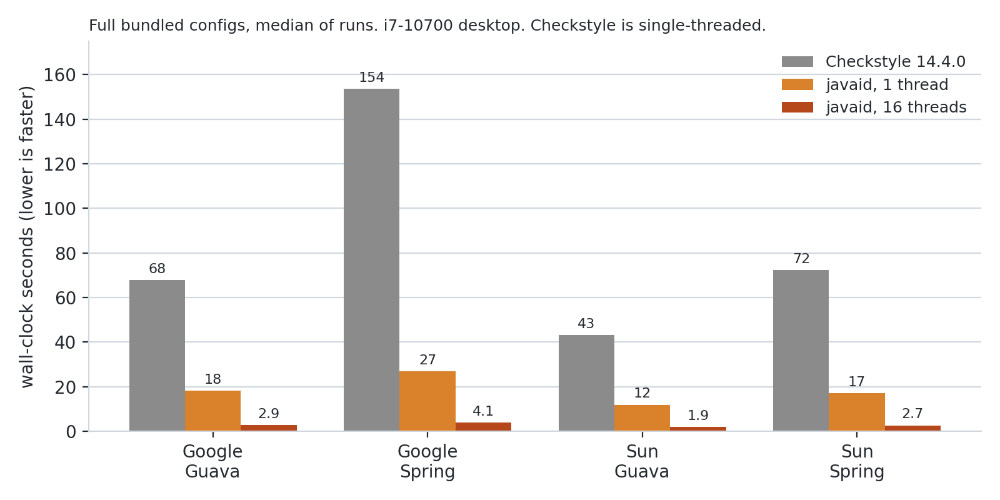

# javaid

**A Checkstyle-compatible Java linter in Rust.** Point it at your existing `checkstyle.xml` and get
the findings Checkstyle 14.4.0 prints, in a fraction of the time. See [Limits](#limits) for what is
not covered.

[](#license)
[](https://github.com/rsmb7z/javaid/actions/workflows/ci.yml)
[](CHANGELOG.md)

- **Same findings as Checkstyle.** Same file, line, column, rule and message. With Checkstyle's
  bundled Google and Sun configs, zero differences on Guava and Spring Framework: 1,778,237 findings
  with Google's, 1,696,055 with Sun's, leaving out Checkstyle's Javadoc parse-error lines
  ([how it is verified](#how-it-is-verified)).
- **Reads your existing config.** It reads `checkstyle.xml`. All 128 modules used by Checkstyle's bundled
  `google_checks.xml` and `sun_checks.xml` are implemented. Anything it cannot run is named on
  stderr, never skipped silently.
- **3.6x to 5.7x faster on one thread, 22x to 38x on 16**, in 37 to 400 MB instead of 3.0 to 3.9 GB.
  One file takes 9 to 15 ms instead of 1.0 to 1.3 s, short enough for an editor or a pre-commit hook.

## See it work

After [installing javaid](#install), run this from a clone of this repo. `docs/demo/` holds a 14-line
file with a few problems. Fetch Google's configuration (the `google_checks.xml` Checkstyle 14.4.0
ships) and run it:

```console
$ cd docs/demo
$ curl -LO https://raw.githubusercontent.com/checkstyle/checkstyle/checkstyle-14.4.0/src/main/resources/google_checks.xml
$ javaid --config google_checks.xml src
javaid: google_checks.xml: running 106 module(s), skipped 0
src/demo/Demo.java:3:17: AvoidStarImport: Using the '.*' form of import should be avoided - java.util.*.
src/demo/Demo.java:5:1: MissingJavadocType: Missing a Javadoc comment for 'Demo'.
src/demo/Demo.java:6:15: GoogleNonConstantFieldName: Non-constant field name 'Count' must start lowercase, be at least 2 chars, avoid single lowercase letter followed by uppercase, contain only letters, digits or underscores, with underscores allowed only between adjacent digits.
src/demo/Demo.java:8:3: MissingJavadocMethod: Missing a Javadoc comment for 'do_work'.
src/demo/Demo.java:8:15: GoogleMethodName: Method name 'do_work' has invalid underscore usage, underscores only allowed between adjacent digits.
src/demo/Demo.java:9:5: NeedBraces: 'if' construct must use '{}'s.
src/demo/Demo.java:11:9: Indentation: 'for' child has incorrect indentation level 8, expected level should be 6.
$ echo $?
1
```

Checkstyle 14.4.0 prints the same seven findings, in its own output format. The first line goes to stderr and says how many of your configuration's modules ran. The
exit status is 1 if anything is reported, so it works in CI and hooks as it is.

## javaid vs Checkstyle

The full bundled configs, wall-clock seconds (medians of 3 runs for javaid, 2 for Checkstyle), on an
i7-10700 desktop (8 cores, 16 threads).
Guava has 3,277 files and Spring Framework 9,293.

<picture>
  <source media="(prefers-color-scheme: dark)" srcset="https://raw.githubusercontent.com/rsmb7z/javaid/main/docs/img/benchmark-dark.png">
  
</picture>

| config, corpus | Checkstyle 14.4.0 | javaid, 1 thread | javaid, 16 threads |
|---|---:|---:|---:|
| Google, Guava | 67.9 s | 18.2 s (3.7x) | 2.88 s (24x) |
| Google, Spring | 153.6 s | 26.8 s (5.7x) | 4.06 s (38x) |
| Sun, Guava | 43.3 s | 12.0 s (3.6x) | 1.94 s (22x) |
| Sun, Spring | 72.4 s | 17.1 s (4.2x) | 2.67 s (27x) |
| Peak memory | 3.0 to 3.9 GB | 37 to 300 MB | 190 to 400 MB |
| One file (`Joiner.java`), process start to exit | 1.0 to 1.3 s | 9 to 15 ms | not applicable |

Checkstyle runs on one thread, so the one-thread column is the like-for-like comparison. The one-file
row is process start to exit: the mean of 100 runs for javaid, the median of 10 for Checkstyle. The machine
is an ordinary desktop, not an isolated benchmark box. Method, raw data and the script are in
[bench/results/full-configs.md](bench/results/full-configs.md).

## Install

From [crates.io](https://crates.io/crates/javaid), with a Rust toolchain (built and tested with Rust
1.96; the crate uses edition 2024). There are no prebuilt binaries yet.

```bash
cargo install javaid           # installs to ~/.cargo/bin
```

or build from a clone:

```bash
git clone https://github.com/rsmb7z/javaid && cd javaid
cargo build --release          # the binary is target/release/javaid
```

## Use

```bash
javaid --config checkstyle.xml src/      # your Checkstyle configuration
javaid src/                              # every module, at Checkstyle's defaults
javaid --rules NeedBraces,MethodName src/
javaid --list-rules                      # the 128 modules, also in docs/modules.md
javaid --grammar upstream src/           # use the upstream tree-sitter-java grammar (see Limits)
javaid -j 4 --stats src/                 # four threads, timings on stderr
```

Output is one finding per line, `path:line:col: Module: message`. Symlinked directories are followed,
as Checkstyle does (`--no-follow-symlinks` turns that off).

**With your own configuration:** a module javaid does not implement, or a property it cannot honour,
is listed on stderr with the reason, and that module does not run (a custom `<message>` template it
cannot apply is only noted, and javaid prints its own wording). For example:

```
javaid: custom.xml: running 17 module(s), skipped 1
  skipped Foo: not implemented
```

## How it is verified

Checkstyle 14.4.0 is the oracle. A module is accepted only at zero difference from it on:

1. **Two real codebases**, Guava and Spring Framework, compared finding by finding.
2. **Mutated copies** of both, edited so that rare rules fire.
3. **Hand-written probe files**, with Checkstyle's output pinned as fixtures. They run in
   `cargo test`.

The comparison covers file, line, column, rule and message. It leaves out Checkstyle's own "Javadoc
comment ... has parse error" lines (36 with Google's config, 4 with Sun's), which javaid deliberately
does not imitate. Matching the documentation is not enough, because Checkstyle has quirks that javaid
reproduces: a Javadoc attaches only before the first token of a declaration, a comment before an infix
operator is never "trailing", and one message prints `1,152` where another prints `1152`.

To reproduce the comparison and the timings, see [bench/README.md](bench/README.md). The original
experiment that started the project, with its caveats, is in [FINDINGS.md](FINDINGS.md).

## Limits

- **Not all of Checkstyle.** 128 modules, the ones the Google and Sun configs use, filters included.
  Checkstyle 14.4.0's jar has roughly 250 check classes. Issues asking for a module are welcome.
- **Syntax only**, as Checkstyle is: no type resolution. javaid uses the maintained
  `tree-sitter-java-orchard` grammar by default, because upstream `tree-sitter-java` cannot parse
  annotated varargs (`Object @Nullable ... args`), which Spring and Guava use.
- **Plain-text output only.** No XML, SARIF or other formats, no `--fix`, no cache.
- **Some properties, and XPath constructs outside the supported subset, are refused by name**, for
  example `ModifierOrder modifiersOrder` and `ArrayTypeStyle javaStyle=false`.
- **Repeated modules.** Several instances of one module run for a listed set of modules (`LeftCurly`,
  `OperatorWrap`, `SeparatorWrap`, `TypeName`, `RegexpSingleline`, `TodoComment` and a few more, all
  listed in [docs/compatibility.md](docs/compatibility.md)); any other second instance is skipped and
  listed on stderr.
- **Javadoc parse-error lines** that Checkstyle prints for odd Javadoc are not imitated, and a few
  known divergences on odd constructs are listed in the compatibility notes.
- **Reads `.java` files.** Without `fileExtensions`, Checkstyle hands the file-level modules every
  file under the paths; javaid reads `.java` only and prints a note saying so. A Checker-level
  `fileExtensions` adds `.properties` and `.xml` for the text-based modules (line length, tabs,
  regular expressions) only.

The details, with the exact lists, are in [docs/compatibility.md](docs/compatibility.md). How it works
inside is in [docs/architecture.md](docs/architecture.md).

## Status

Version 1.0.0. See [CHANGELOG.md](CHANGELOG.md). Please open an issue if javaid's output differs from
Checkstyle's on your code: attach the configuration and a snippet. That is the most useful bug report.

## Why "javaid"?

When I was a freelancer two decades ago, clients assumed I was a Java expert because of my name. I
wasn't. So I named a Java tool after myself.

## License

javaid is licensed under the [GNU Lesser General Public License, version 2.1 or later](COPYING.LESSER)
(`LGPL-2.1-or-later`), the same terms as Checkstyle. Contributions are accepted under the same terms.
Running javaid, in CI or anywhere else, places no conditions on you or on the code it checks.

Most of javaid is written from Checkstyle's observable behaviour: its findings and message text,
recorded on probe files. Some modules and the emulation of Checkstyle's syntax tree are translated to
Rust from Checkstyle 14.4.0's source; those files name their source and carry Checkstyle's copyright
notice; see [NOTICE](NOTICE).
